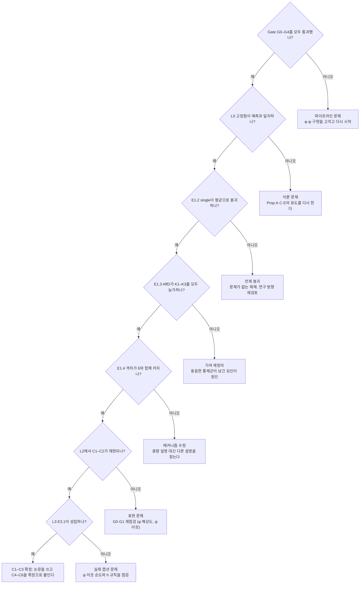
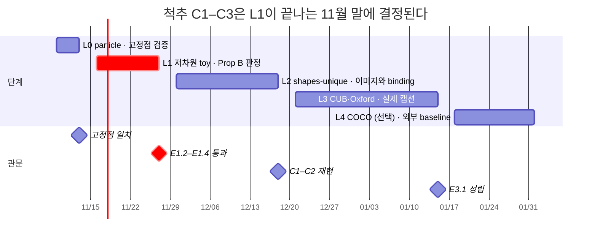

# Affinity Drifting 실험 설계 — Bottom-up 단일 요인 Attribution 플랜

2026-11-07 · Chan Lee

## 1. 연구 네러티브: 주장 사슬

Affinity Drifting(이하 AffD)은 조건 공간의 soft affinity로 이웃 조건의 positive를 빌려오는 drifting이다. 논문 전체는 하나의 사슬이다. single positive는 회귀로 퇴화하고, 그래서 용량이 제한된 생성기는 조건부 평균으로 붕괴한다. 결합 kernel 빌려오기는 이를 mixture로 되돌리고, $h_q$는 평형을 고르며, 대조 negative는 binding을 겨냥한다. 실험은 이 사슬의 고리를 아래 단계부터 하나씩 따로 확인한다.

출발점은 대수적 사실이다. 조건 $c_i$의 positive가 $\mathbf y_i$ 하나뿐이면 정규화된 weight가 1이 되어 attraction이 $\mathbf x$와 무관해진다.

$$
\mathbf V^+(\mathbf x\mid c_i)=\mathbf y_i-\mathbf x
\quad\Longrightarrow\quad
\mathcal L_{\text{attr}}=\big\|f_\theta(\boldsymbol\epsilon,c_i)-\mathbf y_i\big\|^2
$$

| 주장 | 내용 | 이론 근거 | 처음 검증하는 단계 | 반증되면 |
| --- | --- | --- | --- | --- |
| C0 | single-positive drifting의 attraction은 L2 회귀와 같다 | Lemma 0 (위 식) | L1 | 거의 확정. 구현 검증용 |
| C1 | 생성기가 가까운 $c$를 구분하지 못하면 single positive는 조건부 평균으로 붕괴한다 | Prop B | L1 | 연구 전제가 무너진다. 방향 재검토 |
| C2 | 빌려오기가 mixture를 복원하며, 원인은 양성 수가 아니라 x-의존 mean-shift다 | Prop B | L1 | 기여가 데이터 증강으로 축소된다 |
| C3 | C1–C2의 격차는 생성기의 c-해상도가 낮을수록 크고, 무한 용량에서 사라진다 | Prop A + B | L0, L1 | 메커니즘 설명을 수정한다 |
| C4 | $h_q$가 평형을 고른다. 대칭이면 memorization, $h_q=0$이면 NW mixture | Prop A, C | L0, L1 | 설계 축 주장을 철회한다 |
| C5 | 변형 (B)에서 $\gamma$가 guidance scale로 작동한다 | Prop D | L1, L3 | (B)를 ablation으로 내린다 |
| C6 | counterfactual 쌍 negative는 닫힌 형태의 tilting을 만들고 binding을 개선한다 | Prop E | L0, L2 | negative를 부록으로 내린다 |
| C7 | 캡션 빈도 무관성 (부수 효과) | Remark (구 P2) | L1 | 서술에서 뺀다 |

C1 → C2 → C3이 논문의 척추다. C4–C6은 척추가 선 뒤에 붙는 독립 확장이라, 하나가 실패해도 나머지 주장은 유지된다.

## 2. Attribution 프로토콜

모든 비교는 base config B0에서 손잡이 하나만 바꾼 쌍이다. 그 손잡이 말고 다른 설명이 가능하면, 그 설명만 꺼 보는 통제군을 따로 둔다.

### 2.1 Base config B0

| 손잡이 | B0 값 | 고정 이유 |
| --- | --- | --- |
| $\phi$ ($x$ feature) | frozen. L1은 identity, L2 이상은 Gate G0 통과한 encoder | $\phi$ 품질이 결과를 지배하지 않게 (clift 교훈) |
| $\psi$ (캡션 kernel) | frozen. L1은 oracle $\psi(c)=c$, L2 이상은 SigLIP2 text pooled | $\psi$ 학습 시 unconditional 붕괴 |
| $k_x$ | Gaussian, $\sigma$는 초기화 때 한 번 정하고 고정 | 빌려오면 median 거리가 바뀌어 arm마다 $\sigma$가 달라지는 것을 막음 |
| $h_p$ | $N_{\text{eff}}(c) \ge N^* = 16$ 규칙 | 빌려오기 강도를 조건마다 같게 |
| $h_q$ | 0 (같은 프롬프트 샘플로만 repulsion), $M = 8$ | 평형이 명시적이라 해석이 쉬움. $h_p$를 sweep해도 $h_q$가 따라 움직이지 않아 단일 요인이 유지됨 |
| normalization | feature + drift normalization 켬 | 항 간 스케일을 맞춰 $\lambda$, $w$가 의미를 갖게 |
| negative | self만 | negative 효과는 C6에서만 연다 |
| bank | 모든 arm이 같은 $N_{\text{bank}}$ 집합 | 데이터 양 차이 배제 |
| 학습 | optimizer, lr, 프롬프트 batch B, 스텝, EMA 동일 | 계산량 매칭 |

### 2.2 규칙

1. **한 번에 한 손잡이.** 실험마다 B0 대비 바뀐 것을 $\Delta$ 하나로 적는다. 교호작용이 주장인 C3만 2요인 factorial이고, 이때도 인접 셀끼리는 1요인 차이다.
2. **같은 코드 경로.** single positive는 별도 구현이 아니라 $h_p \to 0$ ($w$를 one-hot)으로 만든다. 구현 차이가 요인으로 섞이지 않는다.
3. **스케일 매칭.** drift normalization으로 항마다 $\mathbb E\lVert V\rVert^2/C \approx 1$을 맞추고, 항별 $\lVert V\rVert$를 로깅한다. 효과가 실제 학습률 차이에서 오는지 배제한다.
4. **사전 등록.** 각 실험의 예측과 반증 기준을 실행 전에 이 문서에 적는다 (각 Level 표의 ‘예측’ 열).
5. **수치로만 판단.** $\lVert V\rVert^2$는 proper score가 아니므로 성능 지표나 $h$ 튜닝 기준으로 쓰지 않는다.

### 2.3 메커니즘 통제군 (C2의 대안 설명 배제)

| 통제군 | B0 대비 바꾸는 것 | 배제하는 대안 설명 | Prop B의 예측 |
| --- | --- | --- | --- |
| K1 x-kernel 제거 | $k_x \equiv 1$. 같은 positive, $x$-의존성만 제거 | 타깃을 평균낸 것만으로 이득이 난다 | NW 조건부 평균으로 붕괴 (single과 같은 실패) |
| K2 무작위 빌려오기 | 같은 $N_{\text{eff}}$, 캡션 이웃을 무작위로 | 의미 이웃이 아니라 양성 수가 이득이다 | 다양하지만 조건에 어긋남 (조건 정확도 붕괴) |
| K3 잡음 넣은 single | $y_i$에 잡음. 분산을 빌려온 positive의 분산과 맞춤 | target smoothing이나 정규화 효과다 | mode 구조 없이 퍼진 blob |
| K4 oracle multi-positive | $p(x\mid c)$에서 진짜 샘플 여러 개 | (상한) | 빌려오기의 편향 = K4와의 격차 |
| K5 $h_p \to \infty$ | 모든 캡션을 균일 가중 | (하한) | unconditional, 조건 무시 |

C2를 주장하려면 AffD가 single, K1, K2, K3보다 모두 낫고 K4에 가까워야 한다. 하나라도 AffD와 같으면, 그 통제군이 남긴 요인이 이득의 원인이다.

### 2.4 통계

- 시드: L0–L1은 5개, L2–L3은 3개. 모든 arm이 같은 시드 집합을 써서 쌍으로 비교한다.
- 보고: 평균과 95% bootstrap CI, 그리고 쌍별 차이의 CI. ‘차이 없음’은 차이의 CI가 사전에 정한 동등 범위 안에 들 때만 주장한다.
- 로깅: 항별 $\lVert V\rVert$, 조건별 $N_{\text{eff}}$ 분포, 실효 $\lambda$와 $w$, kernel 계산 비용.

## 3. 선행 Gate: 주장 실험 전에 통과할 것

각 Level의 주장 실험은 아래 Gate를 모두 통과한 뒤에만 돌린다. Gate가 있어야 실패를 AffD 탓으로 돌릴지, 파이프라인 탓으로 돌릴지 가릴 수 있다. clift의 도형 실패가 이 구분 없이는 해석되지 않았던 사례다.

| Gate | 확인하는 것 | 통과 기준 | 실패 시 조치 | 적용 |
| --- | --- | --- | --- | --- |
| G0 $\phi$ 해상도 | $k_x$가 모든 조건 속성을 구분하는가 | 실제 이미지 속성별 linear probe $\ge 0.95$. $\phi$ 공간 top-10 이웃의 속성 일치율 $\ge 0.9$. 속성별 $\lVert\Delta\phi\rVert^2$ 비중이 최대 속성의 1/10 이상 | $\phi$를 바꾼다 (다중 스케일, 원래 해상도 MAE). AffD 실험 중단 | L2, L3 |
| G1 $\psi$ 이웃 품질 | 비슷한 캡션이 실제로 비슷한 이미지를 가리키는가 | 캡션 top-k 이웃이 가져온 이미지의 잠재 속성 일치율이 무작위보다 크게 높음 (CUB는 같은 종 비율). 패러프레이즈 쌍의 $\psi$ 거리 < 다른 내용 쌍의 $\psi$ 거리 | $\psi$ 후보를 바꾼다 (T5 pooled + whitening, CLIP text) | L2, L3 |
| G2 구현·스케일 | single positive가 L2 회귀와 수치적으로 같은가 (C0). 항 간 스케일이 맞는가 | repulsion을 끄면 두 기울기의 최대 오차 $< 10^{-5}$. 항별 기울기 norm 비가 $[0.5, 2]$ 안 | 구현 수정. normalization 점검 | 모든 Level |
| G3 Oracle 상한 | 파이프라인이 진짜 다양성을 표현할 수 있는가 | K4 (oracle multi-positive)가 조건부 지표에서 data–data 기준선의 허용 범위 안에 들어옴 | 생성기·$\phi$·학습 설정 문제로 보고 상류를 고친다. AffD 비교는 무의미 | 모든 Level |
| G4 Unconditional | 조건 없는 drifting이 주변 분포를 맞추는가 | 주변 분포 지표가 원 논문 수준의 품질을 보임 | 학습 하이퍼파라미터를 먼저 맞춘다 | 모든 Level |

G3이 가장 중요하다. oracle이 실패하는 설정에서는 single과 AffD가 둘 다 실패하므로, 둘의 차이는 아무것도 말해 주지 않는다.

## 4. Level 0: 비모수 particle 시뮬레이션 (고정점 검증, 3–4일)

L0은 신경망 없이 이론의 고정점만 확인한다. q를 조건마다 자유롭게 움직이는 particle M개로 두므로 용량이 무한한 경우에 해당한다. 여기서 나온 결과는 이후 단계에서 ‘용량 제한이 없을 때의 기준’이 된다.

설정: 조건 $c_k$ ($k = 1, \dots, K$, $K = 32$)를 한 직선 위에 두고, 조건마다 data point $y_k \in \mathbb R^2$를 하나씩 둔다 (single-positive 체제). particle은 $x \leftarrow x + \eta V(x\mid c)$로 갱신하고, $\lVert V\rVert < 10^{-6}$이 되거나 스텝 상한에 닿으면 멈춘다.

| ID | 주장 | B0 대비 $\Delta$ | 예측 | 반증 기준 | 지표 |
| --- | --- | --- | --- | --- | --- |
| E0.1 | Lemma 1 | 없음 (구현 검증) | 코드의 $V$와 autograd로 구한 $\sigma^2\nabla\log$ 비가 일치 | 최대 오차 $> 10^{-6}$ | 수치 오차 |
| E0.2 | Prop A | $h_q = h_p$ (대칭) | 모든 유한 $h_p$에서 particle이 $y_k$로 수렴 (memorization) | memorization이 아닌 설정에서 $\lVert V\rVert \approx 0$이 안정적으로 유지됨 | 자기 positive까지 평균 거리, 수렴 스텝 |
| E0.3 | Prop C | B0 그대로 ($h_q = 0$) | 조건 $c_k$의 particle 중 $y_j$에 모이는 비율 $\approx$ $\tilde w_j(c_k)$ | 비율 히스토그램과 $\tilde w$의 TV $> 0.1$ ($M = 256$) | TV(배정 히스토그램, $\tilde w$) |
| E0.4 | Prop A–C 보간 | $h_q \in \{0, 0.25, 0.5, 1\}\cdot h_p$ | $h_q$가 커질수록 NW mixture에서 memorization으로 단조 이동 | 비단조 | TV와 자기 positive 비율 |
| E0.5 | Prop E | negative = counterfactual 쌍, $\lambda \in \{0, .25, .5, .75, .9, 1.1\}$ | 아래 닫힌 형태와 일치. $\lambda \ge 1$이면 발산 | 평균·분산 상대 오차 $> 5\%$ ($\lambda < 1$) | 평형 평균·분산, 발산 여부 |
| E0.6 | 단서 1 (정규화 방식) | pos/neg 합친 softmax ↔ 따로 한 softmax | 고정점은 같고 수렴 경로만 다름 | 고정점이 다름 | E0.2–E0.3 지표 재측정 |

E0.5는 $p_c = \mathcal N(\mu_1, s^2)$, $p_{c'} = \mathcal N(\mu_2, s^2)$로 두면 예측이 닫힌 형태로 나온다. $\sigma$ 평활화를 포함해 $\tilde s^2 = s^2 + \sigma^2$로 쓴다.

$$
\log\hat q_c=\log\hat p_c-\lambda\log\hat q_{c'}
\;\Rightarrow\;
\hat q_c=\mathcal N\!\Big(\tfrac{\mu_1-\lambda\mu_2}{1-\lambda},\;(1+\lambda)\,\tilde s^{2}\Big),\qquad \lambda<1
$$

L0의 결론은 두 가지 중 하나다. 예측이 맞으면 Prop A, C, E가 수치로 확인된 것이고, 틀리면 해당 Prop의 유도를 다시 한다. 어느 쪽이든 신경망을 돌리기 전에 결론이 난다.

## 5. Level 1: 저차원 신경망 toy (핵심, 1–2주)

L1은 논문의 척추인 C1–C3을 결정하는 단계다. 조건부 분포를 정확히 알고, 생성기의 c-해상도를 손잡이 하나로 직접 조절할 수 있기 때문이다.

### 5.1 데이터와 용량 손잡이

- 조건 $c \in [0,1]^2$는 연속이고, 학습 쌍 $N = 10\text{k}$는 각자 고유한 $c_i$를 갖는다. 조건당 positive는 정확히 하나다.
- $p(x\mid c)$는 $\mathbb R^2$의 3-mode Gaussian mixture다. mode 중심은 $c_1$에 따라 회전하고, 반지름과 mixture 비율은 $c_2$에 따라 변한다. 조건부 평균이 mode 사이 빈 곳에 떨어지므로 평균 붕괴가 바로 보인다.
- 생성기는 MLP $f(\epsilon, g(c))$다. **용량 손잡이 $\delta$**는 $c$를 격자 크기 $\delta$로 양자화해 $g$에 넣는 것이다. 같은 칸 안의 $c$는 생성기가 구분할 수 없다. $\delta \in \{0, 1/64, 1/16, 1/4\}$. Prop B의 ‘용량 제한’을 가장 해석하기 쉬운 형태로 구현한 것이다. 두 번째 손잡이로, 양자화 대신 $c$ 경로 $g$에 spectral normalization을 걸어 $c$에 대한 Lipschitz 상수 $L$을 조절하는 버전도 돌린다 ($L \in \{1, 4, 16, 64\}$). 양자화는 칸 경계에서 불연속이고 Lipschitz는 부드럽다. 두 구현에서 같은 경향이 나오면 결론이 제약의 형태에 기대지 않음을 보일 수 있다.
- 지표는 학습 c와 held-out c 256개에서 각각 샘플 512개로 계산한다.

| 지표 | 정의 | 무엇을 잡나 |
| --- | --- | --- |
| 조건부 W2 | 생성 샘플과 $p(\cdot\mid c)$ 샘플의 W2, $c$에 대해 평균 | 종합 품질 |
| MCI (mean-collapse index) | $1 - \operatorname{tr}\mathrm{Cov}_q / \operatorname{tr}\mathrm{Cov}_p$ | 평균 붕괴 (1에 가까울수록 붕괴) |
| off-manifold 비율 | 참 밀도가 기준치 아래인 샘플 비율 | mode 사이 평균 blob |
| mode coverage | 샘플의 5% 이상을 받은 참 mode 비율 | mixture 복원 |
| memorization 비율 | 최근접 학습점까지 거리가 $\epsilon$ 이하인 샘플 비율 | Prop A의 고정점 |

### 5.2 실험

기본 $\delta$는 1/16이다. 모든 비교의 $\Delta$는 AffD(B0) 대비 하나다.

| ID | 주장 | $\Delta$ | 예측 (사전 등록) | 반증 기준 |
| --- | --- | --- | --- | --- |
| E1.1 | C0 | single, repulsion 끔 | 기울기가 L2 회귀와 같음 (G2) | 오차 $> 10^{-5}$ |
| E1.2 | C1 | single ↔ K4 oracle | single은 MCI $\ge 0.5$이고 off-manifold가 높음. K4는 MCI $\le 0.1$ | single의 MCI $< 0.3$. 이때는 문제 자체가 없다 |
| E1.3 | C2 | AffD ↔ single, K1, K2, K3 (각각) | AffD의 W2가 single의 0.5배 이하이고, K1–K3보다도 낮음 (쌍별 CI가 0을 포함하지 않음) | AffD가 어느 통제군과 동등. 그 통제군이 남긴 요인을 원인으로 보고한다 |
| E1.4 | C3 | $\delta \times h_p$ ($h_p \in \{0, 0.5, 1, 2, 4\}\cdot\delta$) factorial. E1.4b는 $\delta$ 대신 Lipschitz 상수 $L$로 같은 factorial | single과 AffD의 W2 격차가 $\delta$에 따라(E1.4b에서는 $L$이 작아질수록) 단조 증가. $\delta = 0$에서는 학습 $c$ 기준 격차가 0에 수렴 | 격차가 $\delta$와 무관 |
| E1.5 | C4 | $h_q = h_p$ ↔ $h_q = 0$, $\delta = 0$, 긴 학습 | 대칭은 memorization 비율이 높고, $h_q = 0$은 NW mixture와의 TV $\le 0.1$ | 두 조건의 평형이 같음 |
| E1.6 | $h$ 선택 | $h_p$ sweep, $N_{\text{eff}}$ 규칙 ↔ 고정 $h$ | W2가 $h$에 대해 U자. 최소점이 $N_{\text{eff}} \approx N^*$ 근처. $\lVert V\rVert^2$ 최소화로 고르면 과하게 큰 $h$가 선택됨 | U자가 아님 |
| E1.7 | C5 | $w$를 변형 (B)로. oracle PMI critic과 학습한 InfoNCE critic, $\gamma \in \{0.5, 1, 2, 4\}$ | $\gamma = 1$이면 $p(x\mid c)$, $\gamma > 1$이면 계산 가능한 $p(x)\,p(c\mid x)^\gamma$에 일치 | 예측 분포와의 W2가 single 수준 |
| E1.8 | C7 | p(c)를 Zipf로. AffD ↔ MMD-joint ↔ MMD-joint + 1/p̂(c) 재가중 | MMD는 tail에서 나빠지고 재가중이 대부분을 회복. AffD는 빈도 구간 간 평탄 | AffD도 tail에서 나빠짐 |
| E1.9 | $\psi$ 품질 | oracle $\psi$에 잡음 차원을 붙이고 잡음 비중 sweep | $\psi$ 잡음이 커질수록 AffD가 K2(무작위 빌려오기)로 수렴 | (텍스트 kernel 평탄화 위험을 수치로 표시) |

가장 중요한 결과물은 E1.4의 phase diagram이다. 가로축 $\delta$, 세로축 $h_p$, 값은 W2로 그리며, 논문 Figure 2 후보다. E1.2의 single 샘플 산점도(mode 사이 blob)는 Figure 1 후보다.

## 6. Level 2: shapes-unique 합성 이미지 (clift 기반, 2–3주)

L2는 L1의 결론이 이미지 공간, 실제 텍스트 $\psi$, 학습된 $\phi$를 거쳐도 유지되는지 확인한다. 잠재 속성을 모두 알기 때문에 oracle 이웃(K4)과 속성별 지표를 여전히 쓸 수 있다.

### 6.1 데이터 설계

- 속성: 도형(3종), 색상 hue(연속), 크기(연속), 위치(연속 2차원), 배경 hue(연속). 32×32, 필요하면 64×64.
- **캡션은 속성의 일부만 말한다.** 예를 들어 위치나 배경을 무작위로 생략한다. 그래야 $p(x\mid c)$에 진짜 다양성이 생기고, 평균 붕괴와 mixture를 구분할 수 있다. clift의 shapes는 모든 속성을 다 말해 이 비교가 불가능했다.
- **캡션은 모두 유일하다.** 연속값을 단어로 표현하고(“slightly left”, “tiny” 등) 문장 템플릿을 여러 개 섞는다. 학습 쌍에서 같은 캡션이 두 번 나오지 않게 한다.
- **빈도는 long-tail.** (도형 × 배경 범주)에 Zipf 분포를 둔다.
- **2-객체 변형**: “a red circle left of a blue square”. 속성이 어느 객체에 묶이는지 평가하는 C6 전용이다.
- 선행 Gate: G0은 원래 해상도에서 학습한 다중 스케일 MAE로 통과시킨다. 숫자·위치 단어에 대한 $\psi$ 이웃 품질은 G1로 먼저 확인한다.

### 6.2 지표

| 지표 | 정의 | 무엇을 잡나 |
| --- | --- | --- |
| 명시 속성 정확도 | 실제 이미지로 학습한 속성 decoder로 측정 | 조건 충실도 |
| 미명시 속성 MCI | 미명시 속성을 decoder로 읽은 분산 / 참 조건부 분산 | 조건부 다양성 (평균 붕괴) |
| 평균 blob 거리 | d(생성, positive 평균) / d(생성, 최근접 실제) | blob이면 1보다 작음 |
| PMI 해독 정확도 | 생성 이미지에서 PMI 정렬로 프롬프트 맞추기 (clift의 도구) | 규칙 판정기가 놓치는 조건 정보 |
| binding 정확도 | 두 객체의 속성이 모두 제 객체에 붙은 비율. 속성별 정확도와 함께 보고 | 속성 오류와 binding 오류의 분리 |

### 6.3 실험

| ID | 주장 | $\Delta$ | 예측 (사전 등록) |
| --- | --- | --- | --- |
| E2.1 | C1 재현 | single ↔ K4 oracle (속성이 같은 이미지 전부) | single은 미명시 속성에서 붕괴 (위치 미명시면 가운데 번진 glyph). blob 거리 $< 1$ |
| E2.2 | C2 재현 | AffD ↔ single, K1, K2, K3 | E1.3과 같은 순서 |
| E2.3 | $\psi$ 선택 | $\psi \in$ {SigLIP2 text, T5 pooled + whitening, CLIP text, oracle 속성 $\psi$} | oracle이 상한. SigLIP2가 실제 $\psi$ 중 최선. 격차는 G1 이웃 순도와 비례 |
| E2.4 | (A) ↔ (B) | $w$의 형태만. $N_{\text{eff}}$를 맞춘 상태에서 | 비슷한 품질. (B)는 캡션 없는 이미지를 더해도 이득이 남음 |
| E2.5 | kernel 형태 | Gaussian product ↔ 명시적 Laplace product | 고정점 주장(Prop A–C)은 Gaussian에서만 성립. Laplace는 실험적 비교로만 보고 |
| E2.6 | C6 | 2-객체. negative $\in$ {self, uncond CFG, mismatched real, counterfactual 쌍}, 같은 $\lambda$에서 하나씩 추가 | counterfactual이 binding 정확도를 가장 많이 올리고, 속성별 정확도는 나머지와 비슷 |
| E2.7 | C7 | 빈도 구간별 지표만 따로 집계 | tail 구간에서 AffD가 평탄 |

clift와 겹치는 영역이다. 데이터 생성기, PMI 해독 도구, $\phi$ 학습 코드는 가져다 쓰고, 역할은 팀원과 먼저 나눈다.

## 7. Level 3: CUB-200 / Oxford-102 실제 이미지 (3–4주)

L3은 실제 캡션에서도 C1–C2가 보이는지를 본다. 두 데이터셋은 이미지당 캡션이 10개이고 종·품종 라벨이 있어, 캡션 유일 조건을 인위적으로 만들고 근사 oracle을 둘 수 있다.

### 7.1 설정

- 해상도: CUB 64×64 픽셀로 시작하고, 필요하면 256 latent + 작은 DiT로 올린다.
- $\phi$: frozen latent-MAE (원 논문 방식) 또는 다중 스케일 DINOv2. G0은 종 linear probe로 확인한다.
- $\psi$: SigLIP2 text pooled (B0). 조건화 encoder는 T5 계열로 모든 arm에서 같다.
- **캡션 유일 조건**: 이미지마다 캡션 10개 중 하나만 고정해 쓴다.
- **근사 oracle K4**: 같은 종의 이미지 전부를 positive로 쓴다. 캡션이 종 수준 속성을 말한다는 가정에 기대므로 ‘근사’다.
- **추가 통제군 K6 캡션 증강**: 10개 캡션을 모두 쓰되 각 캡션의 positive는 여전히 자기 이미지 하나다. ‘이미지당 캡션 수’가 아니라 ‘캡션당 positive 수’가 요인임을 보여 준다.

### 7.2 지표

- 분포: FID, FD-DINOv2.
- 조건부 다양성: 프롬프트당 16개 샘플의 DINOv2 쌍별 거리. 같은 종 실제 이미지의 값과 비교한다.
- 조건 충실도: held-out 캡션으로 생성한 이미지의 종 분류 정확도 (실제 이미지로 학습한 분류기). VQAScore로 속성 질문.
- 암기: 학습 이미지와의 최대 DINOv2 유사도가 0.95를 넘는 비율.
- CLIP·SigLIP 점수는 $\psi$와 같은 계열이라 보조로만 쓴다.

### 7.3 실험

| ID | 주장 | arm 또는 $\Delta$ | 예측 |
| --- | --- | --- | --- |
| E3.1 | C1–C2 주 표 | single, K6, K1, K2, AffD (A), AffD (B), K4 | 다양성과 종 정확도에서 $\text{single} \approx \text{K6} < \text{K1}, \text{K2} < \text{AffD} \le \text{K4}$ |
| E3.2 | $h$ 선택 | $h_p$ sweep, $N_{\text{eff}}$ 규칙 | L1의 U자 재현 |
| E3.3 | C4 | $h_q = h_p$ ↔ 0 | 대칭에서 암기 비율이 더 높음 |
| E3.4 | C5 | 변형 (B)의 $\gamma$ sweep ↔ single + CFG | $\gamma$가 CFG와 비슷한 품질–다양성 trade-off 곡선을 만듦 |
| E3.5 | C6 | counterfactual negative (색 단어 교체, 예: “red wing” → “blue wing”) | VQAScore 속성 항목 상승, FID 유지 |
| E3.6 | 일반화 | 150종 학습, 50종 캡션으로 평가 | AffD가 처음 보는 종에서도 속성 충실도가 더 높음 |

Oxford-102에서는 E3.1만 재현해 데이터셋에 의존하는 결과가 아님을 보인다. 연구실 GPU 자원으로 이 단계를 돌릴 수 있는지는 아직 확인하지 않았다.

## 8. Level 4 (선택): COCO / CC3M 와 외부 baseline

L4는 새 주장을 세우는 단계가 아니다. L1–L3의 결론이 표준 T2I 설정과 경쟁 방법 옆에서도 유지되는지 확인한다. 256 latent, 같은 backbone을 쓴다.

| baseline | 무엇을 고정하고 무엇이 다른가 | 보여 주는 것 |
| --- | --- | --- |
| iRDM식 MMD joint kernel | $\psi$, $\phi$, kernel은 같고 정규화만 다름 | 남는 차이가 정규화다 (Lemma 1, C7) |
| Priming식 single positive | 빌려오기만 없음 | 현재 T2I drifting의 실패 양상 (C1) |
| BTJD식 Sinkhorn joint field 사영 | field 종류만 다름 | kernel mean-shift와 OT field의 비교 |
| 같은 backbone의 diffusion/flow (다중 NFE) | 참고용 상한 | 1-NFE의 위치 |

- 지표: GenEval, VQAScore (주), FID, FD-DINOv2, 프롬프트 내 다양성. CLIP 기반 점수는 보조.
- 공정성: 모든 arm이 같은 스텝, 같은 초기화를 쓴다. 부담을 줄이려고 Priming식 재구성 사전학습으로 초기화한다면 모든 arm에 똑같이 적용한다.
- 들어가는 조건: L3의 E3.1에서 C2가 성립하고 연산 자원이 확보됐을 때만.

## 9. Go/no-go 결정 트리

관문은 위에서부터 차례로 통과한다. 어느 관문에서 멈추든 실패 원인은 그 관문이 시험한 요인 하나로 귀속된다.

Gate는 파이프라인, L0는 유도, E1.2–E1.4는 차례로 전제·메커니즘·용량 설명, L2–L3는 표현과 실제 캡션을 책임진다. E1.2에서 멈추면 논문의 전제가 무너지므로 가장 먼저, 가장 싸게 확인해야 한다.

## 10. 정성 분석 figure 플랜

모든 실험은 수치와 함께 미리 정한 figure 세트를 자동으로 낸다. figure는 수치가 놓치는 실패 양상을 보려는 것이고, arm 간 차이가 하나의 요인에서 왔음을 눈으로도 확인하는 도구다.

### 10.1 원칙

1. **같은 $\epsilon$, 같은 프롬프트.** 학습 전에 probe set(조건 16개 × $\epsilon$ 시드 16개)을 고정한다. 쉬운 조건, 어려운 조건, tail 조건을 섞는다. 모든 arm이 같은 probe set으로 그리므로, 나란히 놓은 패널의 차이는 arm의 차이뿐이다.
2. **같은 배치.** 행 = arm (single, K1, K2, K3, AffD, K4 순서 고정), 열 = 조건. arm별 색도 문서 전체에서 고정한다.
3. **자동 생성.** 평가가 끝날 때마다 `make_figures.py <run_dir>`가 아래 세트를 만들고 config hash와 함께 저장한다. 손으로 고른 샘플은 쓰지 않는다.
4. **블라인드 판독.** 주요 비교 figure는 arm 이름을 가린 채 먼저 보고, 관찰을 세 줄로 적은 뒤 라벨을 연다. 기대에 맞춰 읽는 편향을 줄인다.
5. **사전 등록한 판독 기준.** 각 figure마다 ‘예측이 맞으면 무엇이 보여야 하는가’를 아래 표에 미리 적어 둔다.

### 10.2 모든 run에 공통으로 내는 figure

| ID | figure | 판독 기준 |
| --- | --- | --- |
| FC.1 | 항별 $\lVert V\rVert$ 학습 곡선 ($V^+$, $V^-$, negative별) | 항 간 스케일이 $[0.5, 2]$ 안. 한 항이 죽거나 폭주하면 비교 무효 (G2) |
| FC.2 | 조건별 $N_{\text{eff}}$ 히스토그램 | 대부분 $N^*$ 근처. $N_{\text{eff}} = 1$에 몰린 조건은 사실상 single |
| FC.3 | probe set 샘플 그리드 (체크포인트별) | 학습 중 언제 다양성이 생기거나 사라지는지 |
| FC.4 | $\epsilon$ 보간 strip: $\epsilon_0 \to \epsilon_1$을 16단계로 보간한 출력 | mixture면 mode 사이를 **건너뛰고**, blob이면 매끄럽게 **변형**된다. Prop B를 가장 직접 보여 주는 판독 |

### 10.3 Level 0 figure

| ID | 실험 | figure | 판독 기준 |
| --- | --- | --- | --- |
| F0.1 | E0.2–E0.3 | particle 궤적 스냅샷 ($t = 0$, 중간, 끝), 조건별 색 | 대칭은 자기 $y_k$로 모이고, $h_q = 0$은 이웃 $y_j$들에 나뉘어 모임 |
| F0.2 | E0.3 | 배정 행렬(조건 $k$ × positive $j$에 모인 비율)과 $\tilde w$ 행렬을 나란히 그린 heatmap | 두 행렬의 띠 구조가 같음 |
| F0.3 | E0.4 | $h_q$ 보간 strip: $h_q$ 4개 값의 최종 배정 행렬 | 띠가 점점 대각선으로 좁아짐 |
| F0.4 | E0.5 | $\lambda$별 평형 히스토그램 + 닫힌 형태 Gaussian 겹쳐 그리기, $\lambda = 1.1$은 발산 궤적 | $\lambda < 1$은 곡선이 거의 겹침. 평균이 $\mu_1$에서 멀어지는 방향 |
| F0.5 | E0.2 | $V$ field quiver (조건 하나, 대칭 ↔ $h_q = 0$) | $h_q = 0$에서 여러 basin이 보임 |

### 10.4 Level 1 figure

| ID | 실험 | figure | 판독 기준 |
| --- | --- | --- | --- |
| F1.1 | E1.2–E1.3 | 산점도 그리드: 행 = arm, 열 = 조건 4개. 참 $p(x\mid c)$ 등고선을 배경에, 조건부 평균을 별표로 | single·K1은 별표 근처에 뭉침, K2는 엉뚱한 mode, K3는 퍼진 구름, AffD·K4는 3개 mode를 덮음. **Figure 1 후보** |
| F1.2 | E1.3 | $V^+$ quiver: single ↔ AffD ↔ K1, 같은 조건 | single과 K1은 모든 화살표가 한 점을 향함 ($x$ 무관). AffD는 mode별 basin으로 나뉨. Prop B의 메커니즘 그림 |
| F1.3 | E1.3 | $\epsilon \to x$ 배정 그림: $\epsilon$ 공간을 출력이 떨어진 mode 색으로 칠함 | AffD는 $\epsilon$ 공간이 영역으로 분할되고, single은 한 색 또는 경계가 흐릿함 |
| F1.4 | E1.4 | $\delta$ × $h_p$ phase diagram heatmap (E1.4b는 $1/L \times h_p$로 한 장 더, 같은 색 척도) (값 = W2, 셀에 MCI 숫자) | $\delta$가 커질수록 single 열과 AffD 열의 색 차이가 커짐. **Figure 2 후보** |
| F1.5 | E1.4 | MCI–$\delta$ 선 그래프 (arm별 선, 시드 CI 띠) | single의 선만 $\delta$와 함께 상승 |
| F1.6 | E1.5 | 최근접 학습점 거리 히스토그램 (대칭 ↔ $h_q = 0$) + 배정 heatmap | 대칭은 0 근처에 몰림 (암기) |
| F1.7 | E1.6 | $h_p$에 대한 W2 U자 곡선과 $\lVert V\rVert^2$ 곡선을 두 축으로, $N_{\text{eff}}$ 규칙이 고른 $h$ 표시 | $\lVert V\rVert^2$는 $h$에 대해 단조 감소, W2는 U자. $\lVert V\rVert^2$로 튜닝하면 안 되는 이유 |
| F1.8 | E1.7 | $\gamma$별 생성 밀도와 예측 $p(x)\,p(c\mid x)^\gamma$ 등고선 겹쳐 그리기 | $\gamma$가 커질수록 조건에 맞는 mode로 집중 |
| F1.9 | E1.8 | 빈도 구간별 W2 막대 (AffD, MMD, MMD + 재가중) + tail 조건 산점도 | MMD만 tail에서 샘플이 덜 수렴 |
| F1.10 | E1.9 | $\psi$ 잡음별 이웃 조건 시각화: 한 $c$가 빌려온 이웃 $c_i$를 가중치 크기로 표시 | 잡음이 커지면 이웃이 조건 공간 전체로 흩어짐 |

### 10.5 Level 2 figure

| ID | 실험 | figure | 판독 기준 |
| --- | --- | --- | --- |
| F2.1 | E2.1–E2.2 | probe 프롬프트 × arm 샘플 그리드 (프롬프트당 $\epsilon$ 8개) | single은 8개가 거의 같고, AffD는 미명시 속성이 다양함 |
| F2.2 | E2.1 | blob 삼중항: 생성 / positive 평균 / 최근접 실제 | single의 생성이 평균 이미지와 닮음 (번진 glyph) |
| F2.3 | E2.1–E2.2 | 미명시 속성의 decoder 출력 히스토그램 (생성 ↔ 참) — 예: 위치 미명시 프롬프트의 위치 분포 | single은 가운데 한 점, AffD는 참 분포와 비슷한 폭 |
| F2.4 | E2.3 | 캡션 이웃 패널: 프롬프트 하나와 $\psi$별 top-8 빌려온 이미지 (가중치 표시) | 좋은 $\psi$는 명시 속성이 맞는 이미지를 가져옴. 숫자·위치 단어에서 $\psi$가 무너지는지 |
| F2.5 | E2.6 | binding 그리드: 2-객체 프롬프트와 그 counterfactual을 나란히, negative 종류별 행 | counterfactual negative 행에서만 색이 제 객체에 붙음 |
| F2.6 | 전체 | 실패 갤러리: decoder가 틀린 샘플을 오류 유형(속성 틀림, binding 틀림, blob)별로 무작위 16개씩 | 어떤 오류가 어느 arm에 몰리는지 |

### 10.6 Level 3–4 figure

| ID | 실험 | figure | 판독 기준 |
| --- | --- | --- | --- |
| F3.1 | E3.1 | 프롬프트당 16샘플 그리드, arm별 (single, K6, AffD, K4) | single과 K6은 거의 같은 새, AffD는 자세·배경·구도가 다양 |
| F3.2 | E3.1 | 실제 캡션 이웃 패널: 프롬프트 → 빌려온 이미지와 그 캡션 | 이웃이 같은 종인지, 단어만 겹치는 이웃(bag-of-words)인지 |
| F3.3 | E3.3 | 생성과 최근접 학습 이미지 쌍 (대칭 ↔ $h_q = 0$) | 대칭에서 거의 복사본이 더 많음 |
| F3.4 | E3.1 | DINOv2 feature UMAP: 종 5개의 실제와 생성, arm별 패널 | AffD는 실제 군집을 덮고, single은 군집 안의 점으로 몰림 |
| F3.5 | E3.4 | $\gamma$ sweep strip과 single + CFG $w$ sweep strip, 같은 프롬프트·$\epsilon$ | 두 strip이 비슷한 품질–다양성 변화를 보임 |
| F3.6 | E3.5 | 속성 쌍: “red wing” ↔ “blue wing”, counterfactual negative 유무 | negative가 있으면 속성 차이가 선명해짐 |
| F3.7 | E3.6 | held-out 종 캡션의 샘플과 그 종의 실제 이미지 | 처음 보는 종의 속성이 생성에 나타나는지 |
| F4.1 | L4 | GenEval 범주별 대표 프롬프트 × baseline 그리드 | iRDM식과 차이가 나는 범주가 tail 프롬프트인지 |

FC.4 ($\epsilon$ 보간)와 F1.2 ($V^+$ quiver)가 가장 중요한 정성 근거다. 둘 다 수치 없이 ‘회귀냐 mode assignment냐’를 직접 보여 준다.

## 11. 논문 figure·table 매핑과 일정

논문 본문은 figure 5개와 table 2개로 주장 사슬을 운반한다. 모두 10장의 자동 생성 figure에서 고르므로, 실험이 끝나면 본문 후보도 이미 있다.

| 논문 위치 | 주장 | 원천 figure / 실험 | 담는 메시지 |
| --- | --- | --- | --- |
| Figure 1 | C1 | F1.1 + F2.2 | single positive는 평균 blob을, AffD는 mixture를 만든다 |
| Figure 2 | C2 | F1.2 + F1.3 (+ FC.4) | 원인은 x-의존 mean-shift의 mode assignment다 |
| Figure 3 | C3 | F1.4 | 격차는 생성기 용량이 낮을수록 커진다 (phase diagram) |
| Figure 4 | C4 | F0.2 + F1.6 | $h_q$가 평형을 고른다 |
| Figure 5 | C6 | F2.5 + F3.6 | counterfactual negative가 binding을 고친다 |
| Table 1 | C1–C2, 통제군 | E3.1 (+ E2.2) | 실제 캡션에서 모든 통제군을 능가 |
| Table 2 | 외부 비교 | L4 | 같은 $\psi$·$\phi$에서 정규화만 다른 MMD 등과 비교 |
| 부록 | C5, C7, $h$ 선택, $\psi$ | F1.7–F1.10, F2.4, F3.2–F3.5 | 부수 주장과 진단 |

L1 종료(11/27)가 가장 중요한 관문이다. 여기서 E1.2–E1.4를 통과하지 못하면 9장의 결정 트리를 따라 방향을 다시 정한다. L3은 겨울방학과 겹치므로 GPU 일정을 미리 확인해야 한다.
