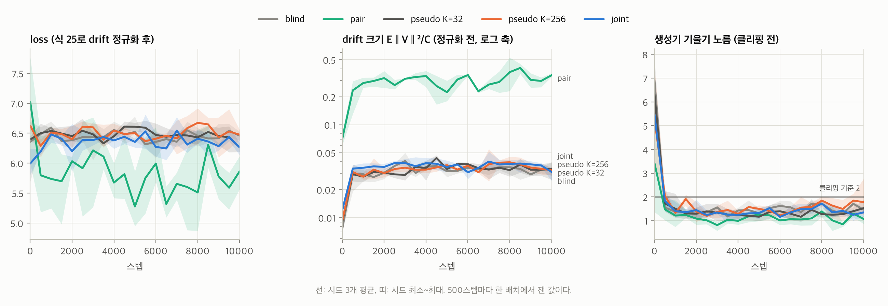
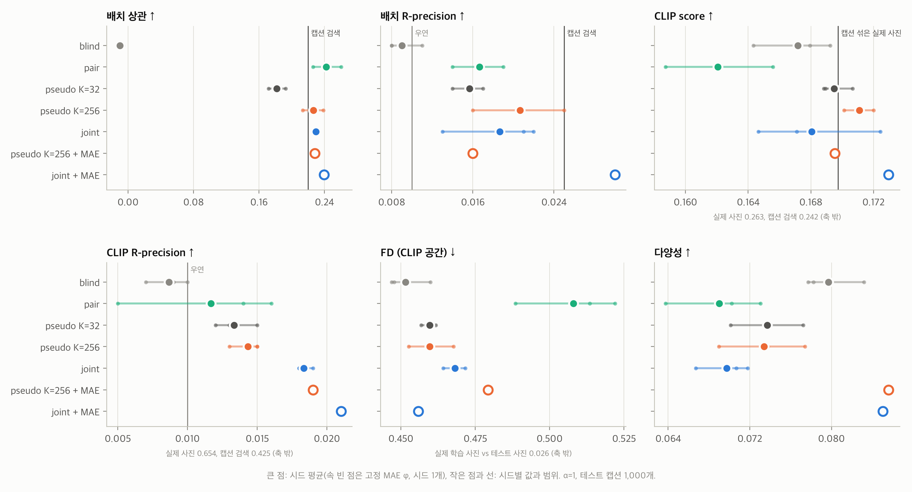
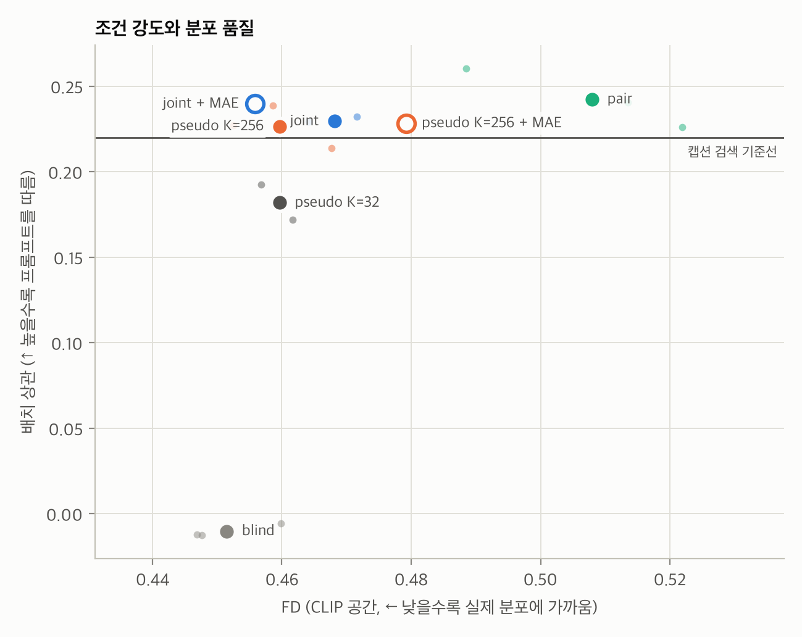
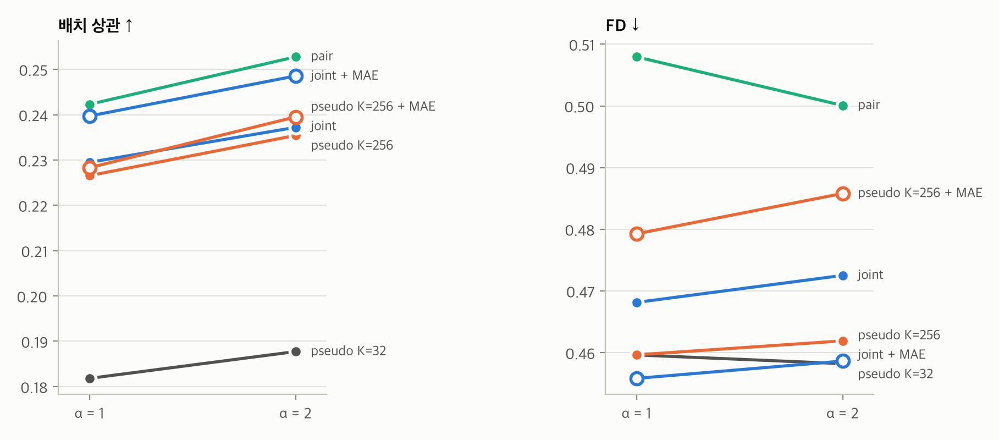
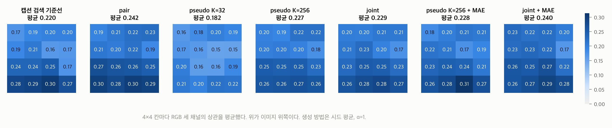
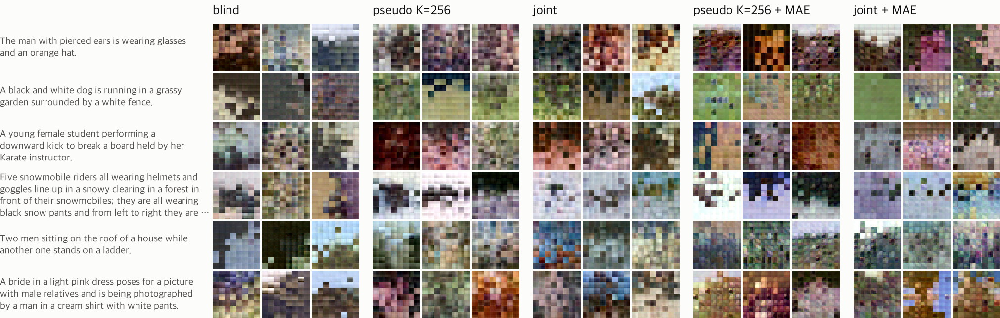
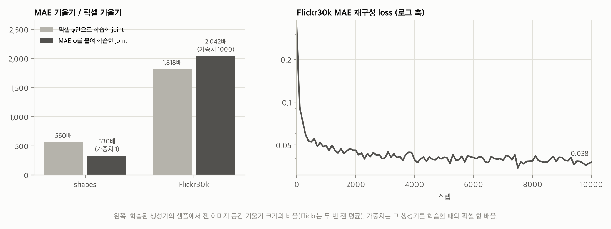
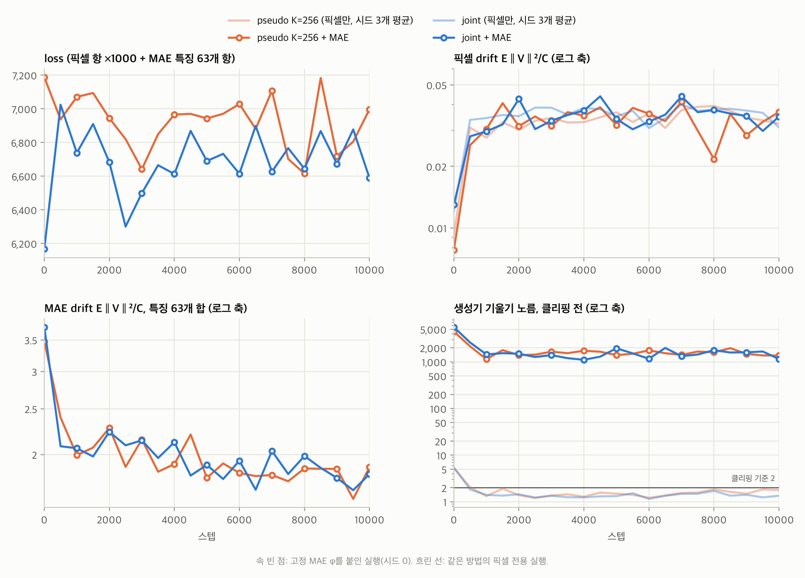
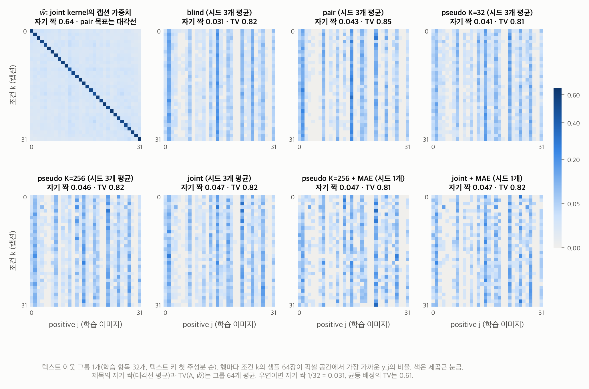
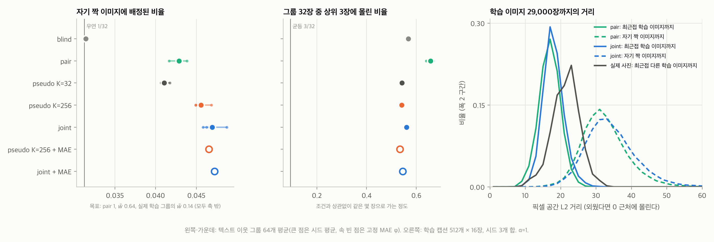

# affinity-drifting 실험 보고: Flickr30k 32×32

작성일: 2026-11-08 (첫 판 2026-11-07, 고정 MAE φ 결과, 그림, 배정 행렬 추가) / 저장소: [lucid-official/affinity-drifting](https://github.com/lucid-official/affinity-drifting)

[Generative Modeling via Drifting](https://arxiv.org/abs/2602.04770)에 CLIP 텍스트 조건을 붙인 구현을 처음으로 실제 사진에서 돌린 결과입니다. 핵심은 loss의 kernel에 텍스트 거리를 넣는 것입니다.

```
k((x,t),(y,s)) = exp(-‖φ(x)-φ(y)‖/τ_x - ‖e(t)-e(s)‖/τ_t)
```

이전 단계에서는 직접 만든 합성 데이터 `shapes`로만 검증했습니다. 그 결과는 [끝에 요약](#이전-단계-합성-데이터-shapes)해 두었습니다.

## 요약

- **텍스트 kernel은 실제 사진에서도 작동합니다.** 텍스트 없는 blind의 배치 상관은 -0.01인데, 텍스트를 넣은 방법은 모두 0.18~0.24입니다. 캡션이 가장 비슷한 학습 사진을 그대로 가져오는 기준선은 0.22입니다.
- **의사 클래스는 K가 충분히 크면 joint와 같습니다.** K=256은 배치 상관 0.227로 joint(0.229)와 같고 FD는 조금 낫습니다. K=32는 0.182로 뚜렷이 낮습니다.
- **pair는 프롬프트를 가장 잘 따르지만 분포를 해칩니다.** 배치 상관은 0.242로 가장 높고, FD는 0.508로 가장 나쁩니다.
- **고정 MAE φ는 joint에서만 도움이 됐습니다(시드 1개).**
  - joint + MAE는 배치 상관 0.240, FD 0.456, 다양성 0.085입니다. 세 지표 모두 픽셀만 쓴 joint의 시드 3개 범위보다 좋습니다.
  - pseudo K=256에 붙이면 FD가 0.479로 오히려 나빠졌습니다.
  - 실행 시간은 약 6~8배로 늘었습니다.
- **의미 수준의 조건은 아직 없습니다.**
  - MAE를 붙인 실행까지 모든 방법의 CLIP score가 캡션을 섞은 실제 사진(0.170) 수준입니다.
  - CLIP R-precision도 0.009~0.021로 우연 수준(0.01) 근처입니다. 같은 해상도의 실제 사진은 0.654입니다.
- **어느 방법도 외우지 않고, joint의 목표 혼합 w̃에도 닿지 않았습니다**([배정 행렬](#샘플은-어느-학습-이미지로-가나)).
  - 샘플은 조건과 상관없이 그룹마다 같은 몇 장의 학습 이미지에 가깝습니다.
  - 텍스트 조건은 우연의 1.3~1.5배인 약한 대각선으로만 보입니다.

## 설정

**데이터:** Flickr30k의 Karpathy 분할(학습 29,000 / 검증 1,014 / 테스트 1,000)입니다.

- 이미지는 중앙을 정사각형으로 잘라 32×32로 줄였습니다.
- 학습에는 이미지마다 첫 번째 캡션 하나만 씁니다. 프롬프트 하나에 이미지 하나라는 아이디어 문서의 전제를 따른 것입니다.
- 평가는 학습에 쓰지 않은 테스트 캡션 1,000개로 합니다. 따라서 처음 보는 문장에 대한 일반화까지 함께 잽니다.

**모델:** 생성기는 4px 패치 트랜스포머입니다(hidden 128, depth 3, heads 4). 텍스트는 고정한 CLIP ViT-B/32에서 pooled 임베딩과 토큰 16개를 받습니다.

**학습:**

- 10,000스텝, AdamW(학습률 4e-4), EMA 0.999, 기울기 클리핑 2.0입니다.
- 한 스텝은 그룹 4개로 이루어지고, 그룹마다 생성 16장과 양성 64장을 씁니다.
- 텍스트 드롭아웃은 0.1, τ_t는 0.2입니다.
- φ는 픽셀만 쓰는 것이 기본입니다. 고정 MAE φ를 붙인 실행은 [따로 정리](#고정-mae-φ)했습니다.
- 실행 하나에 M3 Pro에서 7~8분, joint는 약 10분 걸렸습니다. MAE를 붙이면 약 60분입니다.

**방법:** 모두 같은 생성기에 프롬프트를 넣습니다. 차이는 loss에서 양성을 어떻게 고르느냐입니다.

| 방법 | 양성 | 로드맵 |
|---|---|---|
| blind | 텍스트와 무관한 무작위 이미지 | 기준선 |
| pair | 프롬프트의 짝 이미지 1장 | 기준선 (N_pos=1 문제) |
| pseudo K=32, K=256 | 캡션 임베딩을 k-means로 묶은 같은 군집의 이미지 | 1단계 |
| joint | 텍스트 키 큐에서 찾은 이웃 256개를 텍스트 kernel로 가중 | 2단계 |
| + MAE | 위 방법에 고정 MAE 특징을 φ로 추가 (픽셀 항 ×1000) | φ 고정 실험 |

**평가 지표:** 정답 속성이 없으므로 고정 CLIP 공간과 색 배치로 잽니다. 32×32라 CLIP에는 불리하므로, 같은 해상도의 실제 사진을 상한 기준으로 함께 적습니다.

| 지표 | 무엇을 보나 | 우연 수준 또는 기준 |
|---|---|---|
| 배치 상관 | 4×4로 줄인 색 배치. 프롬프트당 샘플 8장의 평균을 짝 사진과 비교한 Pearson 상관 | 0 |
| 배치 R-prec | 짝 사진과 무작위 사진 99장 중 짝이 가장 가까운 비율 | 0.01 |
| CLIP score | 생성 이미지와 캡션의 코사인 유사도 | 캡션을 섞은 실제 사진 0.170 |
| CLIP R-prec | 제 캡션과 무작위 캡션 99개 중 제 캡션이 가장 가까운 비율 | 0.01 |
| FD | CLIP 이미지 임베딩 공간의 Fréchet distance (생성 vs 테스트 사진) | 학습 사진 vs 테스트 사진 0.026 |
| 다양성 | 같은 캡션 샘플 8장 사이의 평균 코사인 거리 | 붕괴하면 0 |

## 학습 추이



- **loss는 수렴 지표가 아닙니다.**
  - drift를 식 (25)로 정규화한 뒤의 값이라, 처음부터 끝까지 6.0~6.7 근처에 머뭅니다.
  - pair만 낮고 크게 흔들립니다(5.3~6.3).
- **drift 크기(정규화 전 E‖V‖²/C)는 500스텝 안에 정해집니다.**
  - 0.008~0.012에서 0.03 근처로 올라간 뒤 끝까지 거의 그대로입니다.
  - 이 규모에서는 loss도 drift 크기도 학습이 얼마나 진행됐는지 보여 주지 못합니다. 그래서 방법 비교는 평가 지표로 합니다.
- **pair의 drift는 다른 방법의 약 10배(0.34)입니다.** 양성이 한 장뿐이라 끌어당기는 힘이 그 한 장으로만 향하고, 샘플이 그 한 장과 같아지기 전에는 줄지 않습니다. 실제로 끝까지 같아지지 않습니다([배정 행렬](#샘플은-어느-학습-이미지로-가나)). 결과에서 pair의 FD가 가장 나쁜 것과 같은 현상입니다.
- **기울기 노름은 500스텝 안에 5~7에서 1~2로 떨어집니다.** 그 뒤로는 클리핑 기준 2.0 아래라 클리핑이 거의 걸리지 않습니다. MAE를 붙인 실행은 이와 다릅니다([아래](#고정-mae-φ)).

## 결과

시드 3개의 평균 ± 표준편차이고, 가이던스 α=1입니다. 굵은 글씨는 생성 방법 중 가장 좋은 값입니다. 고정 MAE φ 실행은 시드가 하나라 [따로](#고정-mae-φ) 비교합니다.

| 방법 | 배치 상관 | 배치 R-prec | CLIP score | CLIP R-prec | FD | 다양성 |
|---|---|---|---|---|---|---|
| blind | -0.010 ±0.003 | 0.009 ±0.001 | 0.167 ±0.002 | 0.009 ±0.001 | **0.451** ±0.006 | **0.080** ±0.002 |
| pair | **0.242** ±0.014 | 0.017 ±0.002 | 0.162 ±0.003 | 0.012 ±0.005 | 0.508 ±0.014 | 0.069 ±0.004 |
| pseudo K=32 | 0.182 ±0.008 | 0.016 ±0.001 | 0.169 ±0.001 | 0.013 ±0.001 | 0.460 ±0.002 | 0.074 ±0.003 |
| pseudo K=256 | 0.227 ±0.010 | **0.021** ±0.004 | **0.171** ±0.001 | 0.014 ±0.001 | 0.460 ±0.006 | 0.073 ±0.003 |
| joint | 0.229 ±0.002 | 0.019 ±0.004 | 0.168 ±0.003 | **0.018** ±0.000 | 0.468 ±0.003 | 0.070 ±0.002 |
| *기준: 캡션이 가장 비슷한 학습 사진* | *0.220* | *0.025* | *0.242* | *0.425* | *0.026* | |
| *기준: 실제 테스트 사진* | | | *0.263* | *0.654* | *0.026* | |



- **배치 상관:** 텍스트를 넣은 방법은 캡션 검색 기준선(0.22) 근처나 그 위에 있습니다. K=32만 아래입니다.
- **CLIP score:** 모든 방법이 0.162~0.173 사이에서 캡션을 섞은 실제 사진의 선(0.170) 주변에 모여 있습니다. 실제 사진(0.263)과 캡션 검색(0.242)은 축 밖입니다.
- **FD:** 텍스트를 무시하는 blind가 가장 낮습니다. 조건 없이 전체 분포만 맞추는 것이 가장 쉽기 때문입니다. pair가 가장 나쁩니다.
- **다양성:** 속 빈 점(고정 MAE φ)이 0.085~0.086으로 가장 높습니다.

### 조건 강도와 분포 품질



- 왼쪽 위로 갈수록 좋습니다. 프롬프트를 잘 따르면서 실제 분포에도 가깝다는 뜻입니다.
- **pair**는 오른쪽 위입니다. 조건은 강하지만 분포에서 멀고, 시드 사이 편차가 큽니다.
- **pseudo K=256과 joint**는 왼쪽 위에 모여 있습니다. **joint + MAE**가 가장 왼쪽 위입니다.
- **blind**는 FD가 가장 낮지만 조건을 전혀 따르지 않습니다.

### 가이던스 α



- α를 1에서 2로 올리면 모든 방법의 배치 상관이 0.006~0.011 오릅니다. 방법 사이 순서는 바뀌지 않습니다.
- FD는 ±0.008 안에서 움직여 거의 변하지 않습니다. pair만 0.508에서 0.500으로 조금 좋아집니다.
- 다양성은 0.001~0.006 줄어듭니다.
- blind는 텍스트 조건을 배우지 않아 α가 의미가 없으므로 그림에서 뺐습니다.

### 이미지의 어느 부분이 맞나

배치 상관을 4×4 칸별로 나눠 봤습니다. 칸마다 RGB 세 채널의 상관을 평균했고, 생성 방법은 시드 평균입니다. blind는 모든 칸이 0 근처라 뺐습니다.



- **아래쪽이 가장 잘 맞습니다.** 모든 방법과 기준선이 같습니다.
  - joint의 행 평균은 위에서부터 0.205, 0.202, 0.239, 0.272입니다. 캡션 검색 기준선은 0.188, 0.181, 0.223, 0.287입니다.
  - Flickr 사진의 아래쪽은 땅, 잔디, 물, 눈처럼 캡션에서 짐작하기 쉬운 배경인 경우가 많아서로 보입니다.
- **채널별로는 파랑이 가장 잘 맞고 빨강이 가장 덜 맞습니다.** K=32를 빼면 파랑 0.26~0.29, 빨강 0.17~0.19입니다. 하늘, 물, 눈 같은 큰 영역이 텍스트에서 잘 드러나기 때문으로 보입니다.
- **생성 방법이 기준선을 앞서는 곳은 주로 위쪽 두 행입니다.** joint는 0.205와 0.202이고, 기준선은 0.188과 0.181입니다.
- **K=32는 모든 칸에서 낮습니다.** 특히 가운데 두 행이 0.158, 0.176입니다.
- **검증:** 칸별 값은 실험 뒤에 추가한 `experiments/layout_cells.py`로 다시 계산했습니다. 칸별 평균이 17개 실행 모두 `caption_eval.json`의 배치 상관과 소수 셋째 자리까지 같습니다.

### 샘플



**조건:**

- 시드 0의 샘플입니다.
- 프롬프트는 고르지 않고 테스트 캡션 앞에서부터 6개를 썼습니다.
- 방법마다 샘플 3장을 보이고, 32×32 이미지를 화소 그대로 3배 키웠습니다.
- 실제 사진은 라이선스 때문에 넣지 않았습니다.

**관찰:**

- **blind:** 프롬프트와 무관한 색이 나옵니다.
- **pseudo와 joint:** 개는 초록 잔디, 눈썰매는 흰색과 하늘색처럼 장면의 큰 색 구성을 따릅니다.
- **+ MAE:** 4px 패치 안에 잔무늬가 생기고 색 대비가 커집니다. 다양성 지표가 오른 것과 맞습니다. 밝은 배경 위에 어두운 4px 칸이 흩어지는 현상은 픽셀만 쓴 joint에도 있으므로 MAE 탓은 아닙니다.
- **해상도:** 모든 방법에서 4px 패치 경계가 그대로 보일 만큼 거칩니다.

## 고정 MAE φ

아이디어 문서의 판단은 φ를 공동 학습하지 않고 고정하는 것이 기본값이라는 것입니다. 그 고정 φ로 Flickr에서 학습한 MAE를 붙였습니다.

**설정:**

- **MAE:** Flickr30k 학습 사진 29,000장으로 ResNet형 MAE를 10,000스텝 학습하고 고정했습니다. 2×2 패치를 50% 가리고 재구성합니다. 재구성 loss는 0.336에서 0.038로 내려갔고 약 50분 걸렸습니다.
- **φ:** 픽셀 1개에 MAE 특징 63개를 더했습니다. MAE 특징은 인코더의 특징 맵 9개 × A.5의 통계 7종입니다.
- **가중치:** 픽셀 항은 ×1000입니다.
- **실행:** pseudo K=256과 joint, 시드 0 하나씩입니다.

**픽셀 가중치를 1000으로 정한 근거:**



- **측정:** 픽셀만으로 학습한 joint 생성기에서 재면, Flickr에서 MAE 기울기가 픽셀 기울기의 1,818배입니다. shapes에서는 560배였습니다. CLIP은 두 데이터 모두 약 400배입니다.
- **가정:** shapes에서는 MAE를 붙여 학습한 생성기에서 이 비율이 330배로, 0.59배 줄었습니다. Flickr에서도 같은 비율로 줄 것으로 보고 1000을 골랐습니다(1,818 × 0.59 ≈ 1,070).
- **이 가정은 맞지 않았습니다.**
  - 가중치 1000으로 학습한 joint 생성기에서 다시 재 보니 비율은 2,042배로, 오히려 조금 늘었습니다.
  - shapes의 330배는 가중치 1로 MAE 항이 지배하던 생성기에서 잰 값이라, 조건이 달랐습니다.
  - 따라서 이번 실행에서 MAE 항의 기울기는 픽셀 항의 약 2배입니다. 픽셀 항이 묻히지는 않았지만(아래 학습 추이) 1:1 균형은 아닙니다.

**결과:** 같은 방법의 픽셀 전용 실행과 비교했습니다. 픽셀 전용은 시드 3개의 최솟값~최댓값이고, α=1입니다.

| 방법 | 배치 상관 | 배치 R-prec | CLIP score | CLIP R-prec | FD | 다양성 |
|---|---|---|---|---|---|---|
| joint (픽셀, 시드 3개 범위) | 0.227~0.232 | 0.013~0.022 | 0.165~0.172 | 0.018~0.019 | 0.464~0.472 | 0.067~0.072 |
| **joint + MAE (시드 0)** | **0.240** | 0.030 | 0.173 | 0.021 | **0.456** | **0.085** |
| pseudo K=256 (픽셀, 시드 3개 범위) | 0.214~0.239 | 0.016~0.025 | 0.170~0.172 | 0.013~0.015 | 0.453~0.468 | 0.069~0.077 |
| pseudo K=256 + MAE (시드 0) | 0.228 | 0.016 | 0.170 | 0.019 | 0.479 | 0.086 |

굵은 글씨는 픽셀 전용의 시드 범위를 좋은 방향으로 벗어난 값입니다.

- **joint + MAE:** 배치 상관, FD, 다양성이 함께 좋아졌습니다.
  - 배치 R-prec 0.030은 캡션 검색 기준선(0.025)보다 높습니다. 다만 프롬프트 1,000개에서 이 지표의 표준오차가 약 0.005라 차이를 단정할 수 없습니다. CLIP R-prec도 마찬가지입니다.
- **pseudo K=256 + MAE:** 배치 상관은 픽셀 전용의 범위 안이고, FD는 0.479로 범위(0.453~0.468)보다 나쁩니다.
- **공통:** 다양성이 0.085~0.086으로 픽셀 전용(0.067~0.077)보다 높습니다. 샘플에서 보인 패치 안 잔무늬와 맞습니다.
- **의미 수준은 그대로입니다.** CLIP score 0.170, 0.173은 캡션을 섞은 실제 사진(0.170)과 같습니다. MAE 특징을 맞춰도 CLIP이 알아보는 내용은 생기지 않았습니다.

**학습 추이:**



- **픽셀 drift는 픽셀만 쓴 실행과 같은 0.03 근처입니다.** 가중치 1000에서 픽셀 항이 꺼지지 않았습니다. shapes에서 가중치 1일 때는 픽셀 항이 사실상 꺼졌었습니다.
- **MAE drift는 약 3.5에서 1.6~1.9로 절반가량 줄어듭니다.** 픽셀 drift가 줄지 않는 것과 달리, 생성기가 MAE 특징 공간의 차이는 실제로 좁히고 있습니다.
- **기울기 노름은 클리핑 전 1,100~2,000입니다(처음 4,500~5,500).** 매 스텝 2.0으로 잘립니다.
  - AdamW는 기울기의 전체 크기에 거의 둔감하므로 영향은 작을 것으로 봅니다.
  - 다만 스텝마다의 기울기 크기 차이가 사라지므로, 픽셀 실행과 최적화 조건이 정확히 같지는 않습니다.
- **비용:** 실행 하나에 약 60분으로, 픽셀 실행(7~10분)의 6~8배입니다. 스텝마다 생성 64장과 양성 256장을 MAE에 통과시키기 때문입니다.

**판단:** φ는 고정이 기본이라는 방침을 유지합니다. 고정 MAE φ는 joint에서 조건, 분포, 다양성을 함께 조금 올렸습니다. 그러나 시드가 하나이고 pseudo에서는 재현되지 않았으므로, 시드를 늘려 확인하기 전에는 기본 설정으로 올리지 않습니다.

## 샘플은 어느 학습 이미지로 가나

`affinity-drifting` 브랜치의 L0 실험(E0.2~E0.4)은 신경망 없이 입자를 직접 움직여 drift 필드가 어디로 수렴하는지 봅니다. 거기서 쓴 배정 행렬을 학습된 생성기에 그대로 적용했습니다.

**왜 보나:** 그 브랜치의 `docs/plan.md`는 용량이 무한할 때 각 방법이 어디로 수렴하는지 예측합니다.

- **pair:** 양성이 짝 이미지 한 장이므로 그 이미지를 외웁니다.
- **joint:** 우리 구현은 텍스트 kernel을 양성뿐 아니라 생성 샘플(음성)에도 똑같이 겁니다(`text_kernel_for_groups`의 `log_k_neg`). plan의 기호로 h_q = h_p인 대칭 설정입니다.
  - plan의 Prop A는 대칭이면 joint도 외운다고 예측합니다.
  - 음성에 kernel을 걸지 않는 h_q = 0이면 캡션 가중치 w̃의 혼합으로 간다고 예측합니다(Prop C).
- 실제 생성기가 이 중 어디에 있는지 보면, 방법 사이 차이가 이 수렴점 차이에서 오는지 알 수 있습니다.

**측정 (`experiments/assignment.py`):**

- **그룹:** joint 학습과 같은 방식으로 텍스트 이웃 32개를 묶었습니다. 크기 8,192의 큐에서 앵커의 이웃 256개를 찾고, 그중 32개를 고릅니다. 이 32개가 조건 c_k이자 양성 y_k입니다. 그룹은 64개입니다.
- **배정 A_kj:** 조건 k로 샘플 64장을 만들고(α=1), 픽셀 공간에서 y_j가 가장 가까운 샘플의 비율을 셉니다.
- **목표:**
  - pair의 목표는 대각선(단위행렬)입니다.
  - joint의 목표는 w̃_j(c_k) ∝ exp(-‖e_k − e_j‖/τ_t)입니다. 이 그룹에서 w̃의 자기 짝 몫은 평균 0.64입니다.
  - 실제 학습 그룹에서는 짝 이미지가 양성 64장 안에 뽑힐 때만 몫을 받으므로, 자기 짝 몫이 평균 0.14입니다.
- **외우기 확인:** 학습 캡션 512개로 16장씩 만들어 학습 이미지 29,000장 전체와 비교했습니다.



예시는 그룹 0번이고 고르지 않았습니다. 행과 열은 텍스트 키의 첫 주성분 순서입니다.



픽셀 실행은 시드 3개 평균이고, MAE 실행은 시드 0입니다. 거리는 픽셀 공간 L2의 중앙값입니다.

| 방법 | 자기 짝 배정 | 상위 3장 쏠림 | TV(A, w̃) | 짝 이미지까지 | 최근접 학습 이미지까지 |
|---|---|---|---|---|---|
| blind | 0.031 | 0.57 | 0.82 | 35.3 | 18.3 |
| pair | 0.043 | **0.66** | 0.85 | **31.8** | 16.9 |
| pseudo K=32 | 0.041 | 0.54 | 0.81 | 34.7 | 18.5 |
| pseudo K=256 | 0.046 | 0.54 | 0.82 | 34.0 | 18.1 |
| joint | 0.047 | 0.56 | 0.82 | 33.4 | 17.7 |
| pseudo K=256 + MAE | 0.047 | 0.53 | 0.81 | 34.3 | 18.0 |
| joint + MAE | 0.047 | 0.55 | 0.82 | 33.6 | 17.8 |
| *우연 (균등 배정)* | *0.031* | *0.094* | *0.61* | | |
| *목표: pair (외우기)* | *1* | | *0.36* | *0* | *0* |
| *목표: joint w̃ (이 그룹)* | *0.64* | | *0* | | |
| *실제 사진 (자기 자신 제외)* | | | | | *21.8* |

**관찰:**

- **어느 방법도 예측된 수렴점 근처에 없습니다.**
  - 외우지 않습니다. 학습 이미지 전체에서 짝 이미지가 최근접인 샘플은 실행마다 8,192장 중 0~2장입니다(우연이면 약 0.3장). pair도 같습니다.
  - 짝 이미지까지 거리(32~35)는 최근접 학습 이미지까지 거리(17~19)의 약 2배입니다.
  - w̃ 혼합도 아닙니다. TV(A, w̃)가 0.81~0.85로, 균등하게 배정했을 때(0.61)보다도 멉니다.
- **샘플은 조건과 상관없이 그룹마다 같은 몇 장으로 갑니다.** 행렬의 세로 줄무늬입니다.
  - 32장 중 3장이 샘플의 53~67%를 받습니다. 균등하면 9%입니다.
  - 생성 샘플은 실제 사진끼리보다 학습 이미지에 더 가깝습니다(17~19, 실제 사진은 21.8). 특정 사진이 아니라 픽셀 분포의 가운데쯤에 놓인 이미지라는 뜻으로 보입니다.
  - 허브가 흐린 사진만은 아닙니다. 예시 그룹에서 joint 샘플이 가장 많이 간 3장은 색이 많은 군중 사진 2장과 대비가 낮은 흐린 거리 사진 1장입니다. 샘플 자체도 흐릿하기보다 4×4 칸마다 색이 다른 모자이크입니다([샘플](#샘플)).
  - 생성기가 수렴점에 닿지 못한다는 점은 plan의 C3(용량이 제한된 생성기는 조건부 평균으로 붕괴한다)와 어긋나지 않습니다. 다만 샘플이 흐린 평균처럼 보이지는 않으므로, 이것으로 C3를 확인했다고 하지는 않습니다.
- **텍스트 조건은 약한 대각선으로만 보입니다.**
  - blind의 자기 짝 배정은 0.031로 우연과 같습니다. 텍스트를 쓰는 방법은 0.041~0.047로 우연의 1.3~1.5배입니다.
  - joint, pseudo K=256, MAE 실행이 0.046~0.047로 가장 높습니다. pair(0.043)와 K=32(0.041)는 그보다 낮습니다.
- **pair가 허브로 가장 많이 쏠려 있습니다.**
  - 상위 3장 쏠림이 0.66으로 가장 크고, 짝 이미지까지 거리는 31.8로 가장 짧습니다.
  - 짝 이미지 쪽으로는 가장 많이 다가가지만, 짝과 같아지지는 못하고 허브 이미지에 더 가깝습니다.
  - 배치 상관이 가장 높고 FD가 가장 나쁜 결과와 같은 모습입니다. 배치 상관은 샘플 8장 평균의 4×4 색 배치만 봅니다.

**판단:**

- 이 규모(32×32, hidden 128, 10,000스텝)에서는 생성기가 외우기와 w̃ 혼합 어느 쪽에도 닿지 못합니다.
- 따라서 지금 설정에서 h_q를 대칭에서 0으로 바꿔도(plan의 E1.5) 차이는 작을 것으로 봅니다.
- 이 비교는 생성기 용량이나 학습 길이를 먼저 늘린 뒤에 하는 것이 맞습니다.

## 해석

| 항목 | 판단 | 이번 근거 |
|---|---|---|
| 텍스트 kernel | 핵심 메커니즘 확인됨 | 배치 상관 -0.01 → 0.23, 학습에 쓰지 않은 캡션으로 잼 |
| 의사 클래스 vs joint | 의사 클래스부터 시작해도 충분, 단 K가 커야 함 | K=256은 joint와 같고, K=32는 낮음 |
| 의미 수준 (shapes의 도형에 해당) | 진단 필요 | CLIP score가 캡션을 섞은 수준. 고정 MAE φ로도 풀리지 않음 |
| φ | 고정이 기본, 공동 학습 금지 | 고정 MAE φ는 joint에서 소폭 개선(시드 1개) |
| 역방향 탐색 | PMI 정렬, ‖V‖² 선택 기준 금지 | Flickr에서는 아직 시험하지 않음 |

**텍스트 kernel: 확인했습니다.** 합성 데이터에서 본 효과가 실제 사진에서도 재현됩니다.

- 텍스트를 loss에 넣으면 배치 상관이 0에서 기준선 수준으로 오릅니다.
- 학습에 쓰지 않은 캡션으로 잰 값이므로 문장을 외운 결과가 아닙니다.

**의사 클래스 vs joint: 의사 클래스로 시작해도 됩니다. 단, K가 충분히 커야 합니다.**

- K=256은 배치 상관과 FD 모두 joint와 같은 수준이면서 구현이 단순하고 학습도 20% 빠릅니다.
- K=32에서는 군집 하나에 학습 이미지가 평균 900장씩 들어갑니다. 서로 다른 장면이 섞여 조건이 흐려지고, 칸별로 봐도 모든 위치에서 낮습니다.
- joint의 CLIP R-prec가 가장 높지만(0.018), 우연 수준 0.01과의 차이가 작아 의미를 두기 어렵습니다.

**pair는 조건을 가장 강하게 따르지만 분포를 해칩니다.** 아이디어 문서의 N_pos=1 문제가 실제로 나타난 것입니다.

- 양성이 한 장뿐이라 drift가 그 한 장으로 끌려갑니다.
- 학습 중 drift 크기가 다른 방법의 10배로 남고, FD가 가장 나쁘며, 시드 사이 편차도 큽니다.
- 배정 행렬로 보면 pair 샘플은 짝 이미지를 외우지 않습니다. 대신 그룹마다 같은 몇 장의 허브 이미지로 가장 많이 몰립니다(상위 3장 0.66). 짝 이미지의 큰 색 배치 쪽으로는 다가가지만 짝을 재현하지는 못한다고 보면, 배치 상관이 높으면서 FD가 나쁜 것이 함께 설명됩니다.

**의미 수준의 조건은 아직 보이지 않습니다.**

- 생성 이미지의 CLIP score(0.162~0.173)는 캡션을 섞은 실제 사진(0.170)과 같습니다. CLIP이 보기에는 생성 이미지와 캡션이 무관하다는 뜻입니다.
- 합성 데이터에서 도형이 가장 약했던 것과 같은 지점입니다. 큰 색 배치는 픽셀 kernel로 잡히지만, 그보다 세밀한 구조는 픽셀 거리만으로는 잘 학습되지 않습니다.
- 고정 MAE φ를 더해도 패치 안 질감은 바뀌었지만 CLIP score는 그대로입니다.

## 한계

- **해상도와 규모:** 32×32, 10,000스텝, 작은 생성기입니다. 실제 사진 FD(0.026)와 생성 FD(0.45~0.51) 사이의 큰 차이는 대부분 이 규모 때문으로 보입니다. 방법 간 차이를 비교하는 실험이지 품질 실험이 아닙니다.
- **배치 지표:** 샘플 8장의 평균으로 재므로, 샘플이 한 점으로 모일수록 유리할 수 있습니다. 그래서 다양성을 함께 봐야 합니다. 이번에는 다양성이 높은 MAE 실행이 배치 상관도 높아서, 이 편향이 결론을 뒤집지는 않습니다.
- **배치 R-prec:** 기준선도 0.025로 낮고 표준오차가 약 0.005입니다. 사진 한 장을 색 배치만으로 맞히기는 어려워서, 이 지표는 방법 간 차이를 거의 가르지 못합니다.
- **FD:** 표본 1,000개라 편향이 있습니다. Inception 기반 FID는 재지 않았습니다.
- **고정 MAE φ:** 시드 1개, 가중치 1개입니다. 실제 기울기 균형은 픽셀 1 : MAE 2였고, 매 스텝 클리핑이 걸렸습니다.
- **배정 행렬:**
  - 픽셀 L2 최근접으로 배정하므로, 흐린 이미지일수록 여러 이미지에 고르게 가까운 픽셀 거리의 성질이 그대로 들어갑니다.
  - 의미 수준의 배정(예: CLIP 공간)은 재지 않았습니다.
  - TV는 행마다 샘플 64장으로 추정한 값이라 실제보다 크게 나옵니다.

## 다음 단계

- **joint + MAE 시드 추가:** 시드 1, 2를 돌려(약 2시간) 개선이 시드 편차보다 큰지 확인합니다.
- **기울기 균형과 클리핑 맞추기:**
  - 픽셀 항에 1000을 곱하는 대신 MAE 항을 약 1/2,000로 줄이면, 측정한 비율에 맞는 1:1 균형이 됩니다.
  - 그러면 기울기 노름도 픽셀 실행과 같은 1~2가 되어 클리핑 조건이 같아집니다.
  - 지금 코드에는 픽셀 가중치만 있으므로 φ 패밀리별 가중치가 필요합니다.
- **해상도:** 지금 코드는 32×32 픽셀 공간만 지원합니다. 의미 수준의 조건을 보려면 해상도나 생성기 용량을 올려야 할 수 있습니다.
- **h_q 비교:** 생성기가 수렴점에 다가갈 만큼 용량이나 학습 길이를 늘린 뒤, 지금의 대칭 joint와 h_q = 0(음성에 텍스트 kernel을 걸지 않음)을 같은 배정 행렬로 비교합니다(plan의 E1.5).
- **역방향 탐색:** 합성 데이터에서만 시험했습니다. Flickr에서도 PMI 보정 정렬로 시험할 계획입니다. `E‖V‖²`는 정렬 기준으로 쓰지 않습니다.

## 재현

원본은 Hugging Face `nlphuji/flickr30k`의 `flickr30k-images.zip`과 `flickr_annotations_30k.csv`입니다. 이것들을 `data/raw/flickr30k`에 두고 아래를 순서대로 실행합니다. Metal 작업은 한 번에 하나씩 돌립니다.

```bash
.venv/bin/python -I experiments/prepare_flickr30k.py data/raw/flickr30k data/flickr30k_32
SEEDS="0 1 2" bash experiments/run_flickr.sh pixel     # 픽셀 φ 15개 실행 후 평가
.venv/bin/python -m clipdrift.mae --data data/flickr30k_32/train.jsonl \
  --out checkpoints/mae_flickr32.lucid --steps 10000   # 약 50분
SEEDS="0" bash experiments/run_flickr.sh mae            # 고정 MAE φ 2개 실행 후 평가
PYTHONPATH=.:experiments .venv/bin/python experiments/flickr_gradients.py \
  runs/flickr_s10000_pixel_joint_seed0 checkpoints/mae_flickr32.lucid   # 기울기 비율
PYTHONPATH=. .venv/bin/python experiments/layout_cells.py runs/flickr_s10000_*   # 칸별 배치 상관
PYTHONPATH=. .venv/bin/python experiments/assignment.py runs/flickr_s10000_*_seed*   # 배정 행렬
.venv/bin/python experiments/summarize_flickr.py 'runs/flickr_s10000_*'
.venv/bin/python experiments/make_figures.py            # results/figures/*.png
```

**결과 파일:**

- 실행별 지표: `runs/flickr_s10000_*/caption_eval.json`
- 학습 로그: 같은 폴더의 `log.jsonl`
- 칸별 상관: 같은 폴더의 `layout_cells.json`
- 배정 행렬: 같은 폴더의 `assignment.json`, 공통 기준은 `results/assignment_reference.json`
- 기울기 비율: `results/phi_diagnostics.txt`
- MAE 학습 로그: `runs/mae_flickr32/train.log`

**저장소에 넣지 않은 것:**

- **데이터:** `data/`.
- **텍스트 캐시:** `cache/` (1GB).
- **Flickr 체크포인트:** 생성기 132MB와 MAE 26MB입니다. 위 명령으로 다시 만들 수 있습니다.
- **`samples_test.png`:** 실제 Flickr 사진이 들어 있습니다.

## 이전 단계: 합성 데이터 shapes

32×32 합성 데이터(색 4 × 도형 3 × 배경 2)로 검증한 결과입니다. 전체 표는 [README](../README.md)에 있습니다.

- **텍스트 kernel:** 색과 배경 조건이 0.26, 0.49에서 1.00으로 올랐습니다. 학습에서 뺀 조합과 처음 보는 문장 표현에서도 거의 1.00입니다.
- **의사 클래스 vs joint:** 3시드에서 차이가 없었습니다.
- **도형:** pseudo와 joint 모두 3000스텝에서 0.36~0.38로, 우연 수준(0.33)에 가깝습니다.
- **φ로 MAE와 CLIP을 붙인 효과:** 도형 학습을 앞당기지 못했습니다(시드 1개).
  - 가중치 1에서는 φ의 기울기가 픽셀 항의 320~1,440배라 픽셀 항이 사실상 꺼져 있었습니다.
  - 픽셀 가중치를 300으로 올려 품질은 회복했지만, 도형 정확도는 0.36에서 0.38~0.40으로 거의 오르지 않았습니다.
- **φ 공동 학습:** toy에서 붕괴가 재현됐습니다. drift는 더 작은데 분포는 약 11배 나빠집니다.
- **역방향 탐색:** 학습 조합 20개에서 top-1은 PMI 보정 정렬이 1.00으로 가장 좋았고, `E‖V‖²` 최소는 0.60이었습니다.
