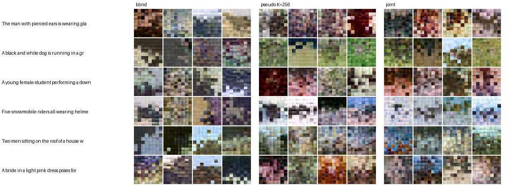

# affinity-drifting 실험 보고: Flickr30k 32×32

작성일: 2026-11-07 / 저장소: [lucid-official/affinity-drifting](https://github.com/lucid-official/affinity-drifting)

[Generative Modeling via Drifting](https://arxiv.org/abs/2602.04770)에 CLIP 텍스트 조건을 붙인 구현을 처음으로 실제 사진에서 돌린 결과입니다. 핵심은 loss의 kernel에 텍스트 거리를 넣는 것입니다.

```
k((x,t),(y,s)) = exp(-‖φ(x)-φ(y)‖/τ_x - ‖e(t)-e(s)‖/τ_t)
```

이전 단계에서는 직접 만든 합성 데이터 `shapes`로만 검증했습니다. 그 결과는 [끝에 요약](#이전-단계-합성-데이터-shapes)해 두었습니다.

## 요약

- **텍스트 kernel은 실제 사진에서도 작동합니다.** 텍스트 없는 blind의 배치 상관은 -0.01인데, 텍스트를 넣은 방법은 모두 0.18~0.24입니다. 캡션이 가장 비슷한 학습 이미지를 그대로 가져오는 기준선은 0.22입니다.
- **의사 클래스는 K가 충분히 크면 joint와 같습니다.** K=256은 배치 상관 0.227로 joint(0.229)와 같고 FD는 조금 낫습니다. K=32는 0.182로 뚜렷이 낮습니다.
- **pair는 장단이 갈립니다.** 프롬프트를 가장 잘 따르지만(0.242), FD가 가장 나쁘고 시드 사이 편차가 큽니다.
- **아직 확인한 것은 대략적인 색 배치까지입니다.** 모든 방법의 CLIP R-precision이 우연 수준(0.01) 근처입니다. 실제 32×32 사진은 0.654입니다. 생성 이미지에 장면의 의미가 들어갔다고 말할 근거는 아직 없습니다.

## 설정

**데이터:** Flickr30k의 Karpathy 분할(학습 29,000 / 검증 1,014 / 테스트 1,000)입니다.
- 이미지는 중앙을 정사각형으로 잘라 32×32로 줄였습니다.
- 학습에는 이미지마다 첫 번째 캡션 하나만 씁니다. 프롬프트 하나에 이미지 하나라는 아이디어 문서의 전제를 따른 것입니다.
- 평가는 학습에 쓰지 않은 테스트 캡션 1,000개로 합니다. 따라서 처음 보는 문장에 대한 일반화까지 함께 잽니다.

**모델:** 생성기는 4px 패치 트랜스포머입니다(hidden 128, depth 3, heads 4). 텍스트는 고정한 CLIP ViT-B/32에서 pooled 임베딩과 토큰 16개를 받습니다.

**학습:**
- 10,000스텝, 학습률 4e-4, EMA 0.999입니다.
- 한 스텝은 그룹 4개로 이루어지고, 그룹마다 생성 16장과 양성 64장을 씁니다.
- 텍스트 드롭아웃은 0.1, τ_t는 0.2입니다.
- φ는 픽셀만 썼습니다.
- 실행 하나에 M3 Pro에서 7~8분, joint는 약 10분 걸렸습니다.

**방법:** 모두 같은 생성기에 프롬프트를 넣습니다. 차이는 loss에서 양성을 어떻게 고르느냐입니다.

| 방법 | 양성 | 로드맵 |
|---|---|---|
| blind | 텍스트와 무관한 무작위 이미지 | 기준선 |
| pair | 프롬프트의 짝 이미지 1장 | 기준선 (N_pos=1 문제) |
| pseudo K=32, K=256 | 캡션 임베딩을 k-means로 묶은 같은 군집의 이미지 | 1단계 |
| joint | 텍스트 키 큐에서 찾은 이웃 256개를 텍스트 kernel로 가중 | 2단계 |

**평가 지표:** 정답 속성이 없으므로 고정 CLIP 공간과 색 배치로 잽니다. 32×32라 CLIP에는 불리하므로, 같은 해상도의 실제 사진을 상한 기준으로 함께 적습니다.

| 지표 | 무엇을 보나 | 우연 수준 또는 기준 |
|---|---|---|
| 배치 상관 | 4×4로 줄인 색 배치. 프롬프트당 샘플 8장의 평균을 짝 사진과 비교한 Pearson 상관 | 0 |
| 배치 R-prec | 짝 사진과 무작위 사진 99장 중 짝이 가장 가까운 비율 | 0.01 |
| CLIP score | 생성 이미지와 캡션의 코사인 유사도 | 캡션을 섞은 실제 사진 0.170 |
| CLIP R-prec | 제 캡션과 무작위 캡션 99개 중 제 캡션이 가장 가까운 비율 | 0.01 |
| FD | CLIP 이미지 임베딩 공간의 Fréchet distance (생성 vs 테스트 사진) | 학습 사진 vs 테스트 사진 0.026 |
| 다양성 | 같은 캡션 샘플 8장 사이의 평균 코사인 거리 | 붕괴하면 0 |

## 결과

시드 3개의 평균 ± 표준편차이고, 가이던스 α=1입니다. 굵은 글씨는 생성 방법 중 가장 좋은 값입니다.

| 방법 | 배치 상관 | 배치 R-prec | CLIP score | CLIP R-prec | FD | 다양성 |
|---|---|---|---|---|---|---|
| blind | -0.010 ±0.003 | 0.009 ±0.001 | 0.167 ±0.002 | 0.009 ±0.001 | **0.451** ±0.006 | **0.080** ±0.002 |
| pair | **0.242** ±0.014 | 0.017 ±0.002 | 0.162 ±0.003 | 0.012 ±0.005 | 0.508 ±0.014 | 0.069 ±0.004 |
| pseudo K=32 | 0.182 ±0.008 | 0.016 ±0.001 | 0.169 ±0.001 | 0.013 ±0.001 | 0.460 ±0.002 | 0.074 ±0.003 |
| pseudo K=256 | 0.227 ±0.010 | **0.021** ±0.004 | **0.171** ±0.001 | 0.014 ±0.001 | 0.460 ±0.006 | 0.073 ±0.003 |
| joint | 0.229 ±0.002 | 0.019 ±0.004 | 0.168 ±0.003 | **0.018** ±0.000 | 0.468 ±0.003 | 0.070 ±0.002 |
| *기준: 캡션이 가장 비슷한 학습 사진* | *0.220* | *0.025* | *0.242* | *0.425* | *0.026* | |
| *기준: 실제 테스트 사진* | | | *0.263* | *0.654* | *0.026* | |

α=2로 올리면 배치 상관이 조금씩 오릅니다. pair 0.253, joint 0.237, pseudo K=256 0.235, pseudo K=32 0.188이고 순서는 그대로입니다. FD는 거의 변하지 않습니다.

아래는 시드 0의 샘플입니다. 프롬프트는 고르지 않고 테스트 캡션 앞에서부터 6개를 썼습니다. 실제 사진은 라이선스 때문에 넣지 않았습니다.



- **blind:** 프롬프트와 무관하게 비슷한 색이 나옵니다.
- **pseudo와 joint:** 개는 초록 잔디, 눈썰매는 흰색과 하늘색, 지붕 위 사람은 위쪽 하늘처럼 장면의 큰 색 구성을 따릅니다.
- **해상도:** 세 방법 모두 4px 패치 경계가 그대로 보일 만큼 거칩니다.

## 해석

**텍스트 kernel: 확인했습니다.** 합성 데이터에서 본 효과가 실제 사진에서도 재현됩니다.
- 텍스트를 loss에 넣으면 배치 상관이 0에서 기준선 수준으로 오릅니다.
- 학습에 쓰지 않은 캡션으로 잰 값이므로 문장을 외운 결과가 아닙니다.

**의사 클래스 vs joint: 의사 클래스로 시작해도 됩니다. 단, K가 충분히 커야 합니다.**
- K=256은 배치 상관과 FD 모두 joint와 같은 수준이면서 구현이 단순하고 학습도 20% 빠릅니다.
- K=32에서는 군집 하나에 학습 이미지가 평균 900장씩 들어갑니다. 서로 다른 장면이 섞여 조건이 흐려집니다.
- joint의 CLIP R-prec가 가장 높지만(0.018), 우연 수준 0.01과의 차이가 작아 의미를 두기 어렵습니다.

**pair는 조건을 가장 강하게 따르지만 분포를 해칩니다.** 양성이 한 장뿐이라 drift가 그 한 장으로 끌려갑니다. 그래서 FD가 가장 나쁘고 시드 사이 편차도 큽니다. 아이디어 문서의 N_pos=1 문제가 실제로 나타난 것입니다.

**의미 수준의 조건은 아직 보이지 않습니다.** 생성 이미지의 CLIP score(0.162~0.171)는 캡션을 섞은 실제 사진(0.170)과 같습니다. CLIP이 보기에는 생성 이미지와 캡션이 무관하다는 뜻입니다. 합성 데이터에서 도형이 가장 약했던 것과 같은 지점입니다. 큰 색 배치는 픽셀 kernel로 잡히지만, 그보다 세밀한 구조는 픽셀 거리만으로는 잘 학습되지 않습니다.

## 한계

- **해상도와 규모:** 32×32, 10,000스텝, 작은 생성기입니다. 실제 사진 FD(0.026)와 생성 FD(0.45~0.51) 사이의 큰 차이는 대부분 이 규모 때문으로 보입니다. 방법 간 차이를 비교하는 실험이지 품질 실험이 아닙니다.
- **배치 지표:** 샘플 8장의 평균으로 재므로, 샘플이 한 점으로 모일수록 유리할 수 있습니다. 그래서 다양성을 함께 봐야 합니다. 이번에는 텍스트를 넣은 방법끼리 다양성이 0.069~0.074로 비슷해 순위에 영향을 주지 않았습니다.
- **배치 R-prec:** 기준선도 0.025로 낮습니다. 사진 한 장을 색 배치만으로 맞히기는 어려워서, 이 지표는 방법 간 차이를 거의 가르지 못합니다.
- **FD:** 표본 1,000개라 편향이 있습니다. Inception 기반 FID는 재지 않았습니다.

## 다음 단계

- **φ 고정 실험(진행 중):** Flickr30k 학습 사진으로 MAE를 학습하고 있습니다. φ는 공동 학습하지 않고 고정하는 것이 기본값입니다. 학습이 끝나면 pseudo K=256과 joint에 붙입니다(`bash experiments/run_flickr.sh mae`).
- **픽셀 가중치 재확인:** 합성 데이터에서는 φ의 기울기가 픽셀 항의 수백 배여서 가중치 300을 썼습니다. Flickr에서 기울기 비율을 다시 재고 가중치를 정합니다.
- **해상도:** 지금 코드는 32×32 픽셀 공간만 지원합니다. 의미 수준의 조건을 보려면 해상도나 생성기 용량을 올려야 할 수 있습니다.
- **역방향 탐색:** 합성 데이터에서만 시험했습니다. Flickr에서도 PMI 보정 정렬로 시험할 계획입니다. `E‖V‖²`는 정렬 기준으로 쓰지 않습니다.

## 재현

원본은 Hugging Face `nlphuji/flickr30k`의 `flickr30k-images.zip`과 `flickr_annotations_30k.csv`입니다. 이것들을 `data/raw/flickr30k`에 두고 아래를 실행합니다.

```bash
.venv/bin/python -I experiments/prepare_flickr30k.py data/raw/flickr30k data/flickr30k_32
SEEDS="0 1 2" bash experiments/run_flickr.sh pixel   # 학습 15개 후 테스트 캡션으로 평가
.venv/bin/python experiments/summarize_flickr.py 'runs/flickr_s10000_*'
```

실행별 지표는 `runs/flickr_s10000_*/caption_eval.json`, 학습 로그는 같은 폴더의 `log.jsonl`에 있습니다. 다음은 저장소에 넣지 않았습니다.
- **데이터:** `data/`.
- **텍스트 캐시:** `cache/` (1GB).
- **Flickr 실행의 체크포인트:** 132MB이고, 위 명령으로 다시 만들 수 있습니다.
- **`samples_test.png`:** 실제 Flickr 사진이 들어 있습니다.

## 이전 단계: 합성 데이터 shapes

32×32 합성 데이터(색 4 × 도형 3 × 배경 2)로 검증한 결과입니다. 전체 표는 [README](../README.md)에 있습니다.

- **텍스트 kernel:** 색과 배경 조건이 0.26, 0.49에서 1.00으로 올랐습니다. 학습에서 뺀 조합과 처음 보는 문장 표현에서도 거의 1.00입니다.
- **의사 클래스 vs joint:** 3시드에서 차이가 없었습니다.
- **도형:** pseudo와 joint 모두 3000스텝에서 0.36~0.38로, 우연 수준(0.33)에 가깝습니다.
- **φ로 MAE와 CLIP을 붙인 효과:** 도형 학습을 앞당기지 못했습니다(시드 1개).
  - 가중치 1에서는 φ의 기울기가 픽셀 항의 320~1,440배라 픽셀 항이 사실상 꺼져 있었습니다.
  - 픽셀 가중치를 300으로 올려 품질은 회복했지만, 도형 정확도는 0.36에서 0.38~0.40으로 거의 오르지 않았습니다.
- **φ 공동 학습:** toy에서 붕괴가 재현됐습니다. drift는 더 작은데 분포는 약 11배 나빠집니다.
- **역방향 탐색:** 학습 조합 20개에서 top-1은 PMI 보정 정렬이 1.00으로 가장 좋았고, `E‖V‖²` 최소는 0.60이었습니다.
